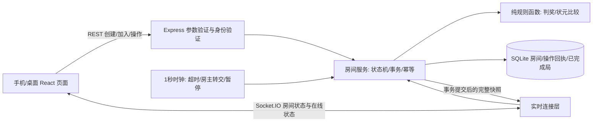
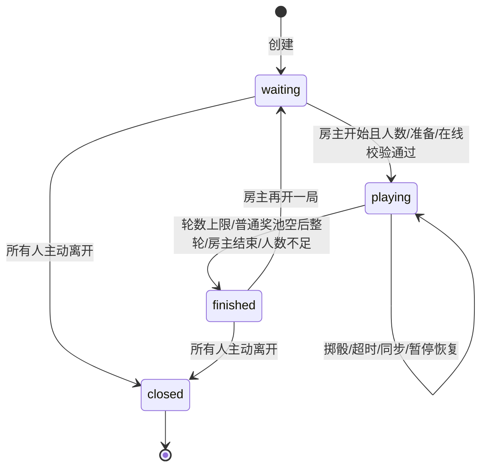

# 月满博饼 · 第一版完整需求与架构

版本：1.0，2026-09-25。状态：已冻结，可按实施计划开发。

## 1. 目标、角色与范围

做一个中文、中秋氛围、手机优先的多人博饼网页。房主创建房间并分享邀请，朋友输入昵称即可一起玩。默认采用[线上统一房规 v1](rules-research.md)。

- 房主：创建、邀请、准备、开始、提前结束、再开一局、离开。
- 成员：加入、准备、轮到自己时掷骰、查看奖池/记录/战绩、离开、重连。
- 访客：查看首页、完整规则和邀请房间概况，输入昵称后加入。
- 本轮交付包含前后端、持久化、多人同步、测试、Docker与上线文档。
- 不做账号密码、支付、红包、聊天、旁观席、好友关系、实物寄送及自定义判奖规则。游戏中不涉及筹码或金额。
- 本地运行与公网部署分开验收；没有公网域名和服务器时，不将localhost邀请冒称可发给互联网上的朋友。

## 2. 页面与流程

### 2.1 首页 `/`

品牌“月满博饼”，主标语“一碗骰声，满桌团圆。”；创建房间、输入6位房间码加入、玩法说明三个明确入口。展示六档奖项速览、6颗骰子与瓷碗主视觉、无需注册的参与步骤。

创建表单：昵称1–12个Unicode字符、房间名1–24字、人数上限2–12整数（默认8）、每人轮数5/10/20（默认10）。默认房名“中秋团圆局”，不能用占位文字替代字段label。提交期间禁用按钮。失败保留输入、显示可操作错误。成功跳转`/room/:code`并保存恢复凭证。

加入表单：房间码忽略首尾空格并转大写，昵称遵守同上规则；同房间昵称不能重复。同浏览器有该房间凭证时，优先恢复身份。

### 2.2 邀请落地页 `/room/:code`

无恢复凭证时先读取概况：房名、人数/上限、轮数、规则名、是否可加入。等待中的房间输入昵称加入；已开始/已结束/已满/已过期时给出对应说明与回首页按钮，不能静默新建本地房间。

有凭证时调用成员状态接口恢复；凭证失效时清理该房间凭证并展示加入页。凭证不能出现在URL、二维码、分享文本、日志或其他玩家数据中。

### 2.3 房间等待区

显示6位房间码、房名、已入座成员、房主标记、在线/离线、准备状态、游戏配置。

- 邀请按钮打开弹层：完整邀请链接、复制链接、二维码、系统分享（支持时）。复制失败必须显示可手动选择的链接，不假报复制成功。
- HTTPS下优先`navigator.share`/Clipboard；HTTP局域网支持手动复制回退。二维码实际编码邀请URL，使用本地库生成。
- 非房主可切换准备；房主默认准备且可切换。仅当至少2人、所有未离开成员都在线且已准备时，房主可以开始。禁用态旁明确原因。
- 房主离开后将房主转给最早入座的未离开成员（在线优先）；房主离线60秒后，如有在线成员，自动转交最早入座的在线成员；原房主回来不自动夺回。

### 2.4 对局区

上方房名、轮次/上限、连接状态；中心显示当前掷骰人、剩余秒数、瓷碗和6颗骰子、上一手牌型结果；下方显示“掷出好运”按钮或等待提示。

- 只有当前玩家能操作掷骰；等待别人、请求中、断线、已结束时禁用，并说明原因。
- 动画约900ms，停下来的点数必须来自服务器响应；支持`prefers-reduced-motion`；网络失败不能擅自显示一组“中奖结果”。
- 当前结果显示名字、6点数、判奖和是否实际领到奖；奖池耗尽、刷新后恢复均有明确文案。
- 旁边/下方显示玩家与准备/在线状态、五类普通奖剩余数、当前状元领先者、获奖明细、完整本局记录（最多240条，可滚动）。超时、离开、结束也有可读记录或状态提示。
- 状元动画强于普通奖，但不遮挡必要操作；音效不作为第一版依赖。
- 房主“提前结束”需应用内二次确认，这是用户产品操作的确认，不是开发代理的审批。
- 离开房间需应用内确认；掉线提示自动重连，不能误当作主动离开。

### 2.5 结算区

显示本局状元或空缺说明、结束原因、所有玩家奖项明细、实际投掷次数、剩余奖池、历史记录。只把实际已发奖品计入总数。房主点击“再开一局”将同房间切回等待区：房码/身份保留，离开者清理，所有奖品和本局记录重置，非房主准备取消，局编号加1；之前局的数据保存在数据库的已完成对局快照中。成员看到“等待房主再开一局”。

### 2.6 规则页 `/rules` 与房间内规则弹层

来自同一份常量数据。展示完整牌型示例、奖池数量、特殊牌型排序、30秒超时、轮数上限、只取最高奖、不兼得、不追普通奖、状元同分先到先得及参考来源。房间里查看规则不离开房间或断开连接。

## 3. 全局约束

- Node.js >=24.0.0；React + TypeScript + Vite；Express + Socket.IO；SQLite使用`node:sqlite`；npm作为包管理器。
- 用户界面与错误提示为简体中文；所有按钮、输入框具有可访问名称；不把框架名、数据库名等实现细节放到普通玩家流程。
- 支持375px、768px、1440px布局；375px不得横向滚动；主要点击目标>=44px。
- 服务端是随机数、轮次、权限、奖池、判奖、结算的唯一权威，客户端不得提交骰子点数或中奖等级。
- 第一版只部署一个Node实例；SQLite持久化目录必须挂载；禁止用多副本启动该版本。
- 应用前后端同源；开发通过Vite代理`/api`与`/socket.io`。生产Express提供构建后的静态文件和SPA路由回退。
- 房间与邀请不含账号个人资料，只有用户输入的昵称和房名。

## 4. 架构与职责



事件采用完整公共快照加递增`revision`。最大12人、每局240条记录，优先保证实现清晰。客户端只接受更新版本；断线重连先GET权威快照，再订阅房间。服务端每次变更落盘成功后广播，不能先广播后保存。

### 4.1 文件边界

```text
shared/types.ts              公共DTO/动作/错误码，无密钥字段
shared/rules.ts              纯判奖函数、比较器、规则显示元数据
server/index.ts              服务入口、生产静态资源、生命周期
server/app.ts                HTTP路由与输入校验
server/db.ts                 SQLite建表、事务、查询、归档
server/room-service.ts       创建/加入/动作/凭证/公共快照
server/game.ts               开局、轮转、发奖、结算的纯逻辑
server/realtime.ts           Socket身份验证、订阅、断连计数、广播
server/clock.ts              超时、暂停恢复、房主转交、过期清理
src/App.tsx                 路由与全局错误区
src/lib/api.ts              REST请求、超时、错误码映射
src/lib/session.ts          按房间保存/恢复匿名凭证
src/hooks/useRoom.ts        快照、Socket订阅、状态合并
src/pages/Home.tsx          首页/创建与房码加入
src/pages/Room.tsx          邀请落地/等待/对局/结算
src/pages/Rules.tsx         规则页
src/components/*            骰子、碗、玩家、奖池、记录、分享弹层
src/styles.css             Pi设计规范的完整响应式样式
tests/rules.test.ts         牌型/穷举/比较
tests/game.test.ts          轮转/奖池/结算/超时
tests/server.test.ts        REST/权限/幂等/持久化/Socket
tests/e2e/*.spec.ts         两个独立浏览器上下文的真实流程
docs/ui-design.md           Pi交付的设计规范
docs/deployment.md          本地、局域网、公网、备份与限制
Dockerfile / compose.yaml   单实例+持久化数据卷
```

## 5. 类型与数据约定

下列为公共接口约束，实现可拆分文件但不能在前后端自行改名。

```ts
type PrizeKey = 'zhuangyuan'|'duitang'|'sanhong'|'sijin'|'erju'|'yixiu';
type ResultCode = 'chajinhua'|'liuhong'|'biandijin'|'liuhe'|'wuhong'|'wuzi'|
  'sihong'|'duitang'|'sanhong'|'sijin'|'erju'|'yixiu'|'none';
type RoomStatus = 'waiting'|'playing'|'finished'|'closed';
type RankKey = [number, number, number];
interface DiceResult { code: ResultCode; label: string; prize: PrizeKey|null; rankKey: RankKey }
interface Player {
  id:string; nickname:string; seat:number; ready:boolean; online:boolean;
  left:boolean; awards:Record<PrizeKey,number>; best:DiceResult|null;
}
interface RollRecord {
  id:string; playerId:string; nickname:string; round:number; turnId:string;
  dice:number[]; result:DiceResult|null; awarded:PrizeKey|null;
  reason:'rolled'|'timeout'; at:number;
}
interface Champion { playerId:string; result:DiceResult; dice:number[]; at:number }
interface RoomState {
  code:string; name:string; maxPlayers:number; maxRounds:5|10|20;
  rulesVersion:'unified-v1'; status:RoomStatus; hostId:string; revision:number;
  players:Player[]; gameNumber:number; round:number; turnPlayerId:string|null;
  turnId:string|null; deadline:number|null; paused:boolean;
  pool:Record<PrizeKey,number>; champion:Champion|null; history:RollRecord[];
  finishedReason:'round-limit'|'pool-empty'|'host-ended'|'players-left'|null;
  createdAt:number; expiresAt:number;
}
interface Membership { roomCode:string; playerId:string; token:string }
type Action =
 | {type:'ready'; ready:boolean}
 | {type:'start'}
 | {type:'roll'; requestId:string; expectedTurnId:string}
 | {type:'leave'}
 | {type:'end'}
 | {type:'rematch'};
```

服务端内部类型额外保存`tokenHash`、`lastSeenAt`、暂停剩余毫秒、本轮结束标记与回合顺序；公共快照必须通过白名单构造，不能直接展开内部成员对象。

SQLite至少三张表：`rooms(code PRIMARY KEY, state_json, expires_at)`；`receipts(room_code, game_number, player_id, request_id, result_json, UNIQUE(...))`；`completed_games(room_code, game_number, state_json, PRIMARY KEY(...))`。启用WAL、外键和busy_timeout；状态变更和roll回执在同一事务提交。房间24小时后过期，过期访问返回410；清理过期房间时同时清理相关回执/归档。数据库文件不得放入Git。

核心审查补充：采用`expired_rooms`保存只有房码和过期时间的轻量标记7天，以便清理完整数据后仍能返回410；7天后清理标记，原码返回404。24小时有效期从创建起固定计算，不随操作续期。服务重启时保存内容不丢失；若重启前deadline已过，剩余时长为0，首次重连后会跳过该回合。

## 6. API与Socket契约

所有时间为Unix毫秒。错误格式统一`{error:{code:string,message:string}}`。所有写接口只接受JSON、限制body 16KiB并验证对象类型和字段。房码用`ABCDEFGHJKLMNPQRSTUVWXYZ23456789`随机生成6位，唯一冲突重试。

| 接口 | 请求 | 成功响应/语义 |
| --- | --- | --- |
| GET /api/health | 无 | 200 `{ok:true}`，数据库可用 |
| GET /api/config | 无 | 200 `{publicBaseUrl:string|null}`；运行时公开分享地址配置，无凭证 |
| POST /api/rooms | `{nickname,name,maxPlayers,maxRounds}` | 201 `{membership,room}`；创建者为房主，默认准备 |
| GET /api/rooms/:code | 无 | 200 `{code,name,playerCount,maxPlayers,maxRounds,status,rulesVersion,canJoin}`；只暴露概况 |
| POST /api/rooms/:code/join | `{nickname}` | 201 `{membership,room}`；只能在waiting加入 |
| GET /api/rooms/:code/state | Bearer token | 200 `{room,playerId}`；用于刷新和断线恢复 |
| POST /api/rooms/:code/actions | Bearer token，`Action` | 200 `{room}`；所有操作走相同事务服务 |

Socket.IO同源连接，handshake `auth:{roomCode,token}`，仅验证成功的成员可以进入对应房间；连接后推送`room:state`，内容`RoomState`。`connect_error`给出可读信息；服务端不接受未经验证的任意房间订阅。相同成员多个连接按引用计数，只有最后一个断开才标离线。`room:state`不得包含凭证或哈希。

### 错误与权限

| HTTP | code | 前端提示 |
| --- | --- | --- |
| 400 | INVALID_INPUT | 请检查昵称、房间码或房间设置 |
| 401 | INVALID_TOKEN | 你的房间身份已失效，请重新加入 |
| 403 | HOST_ONLY | 只有房主可以进行此操作 |
| 403 | NOT_YOUR_TURN | 还没轮到你，请等待其他玩家 |
| 404 | ROOM_NOT_FOUND | 没找到这个房间，请检查房间码 |
| 409 | ROOM_FULL | 房间已满 |
| 409 | ROOM_STARTED | 本局已经开始，暂时不能加入 |
| 409 | NICKNAME_TAKEN | 这个昵称已被使用，请换一个 |
| 409 | NOT_READY | 至少2位玩家在线并准备后才能开始 |
| 409 | STALE_TURN | 这一轮已经结束，已为你同步最新状态 |
| 409 | INVALID_STATE | 当前房间状态不支持此操作 |
| 410 | ROOM_EXPIRED | 房间已过期，可以重新开一桌 |
| 429 | RATE_LIMITED | 操作太快了，请稍后再试 |
| 500 | INTERNAL_ERROR | 暂时无法完成操作，请稍后重试 |

创建/加入每IP每分钟上限30次；其他写操作每身份每分钟上限120次。限流由服务端执行，测试不能依赖客户端节流。

## 7. 状态机与一致性细节



- RNG为`crypto.randomInt(1,7)`，开局起始位同样使用服务端安全随机源。生产API不能接收或注入自选骰子。
- 每个新回合生成UUID `turnId`；roll必须带`expectedTurnId`与UUID `requestId`。先查当前局该玩家的回执，再检查回合；重复请求返回原记录对应的已提交状态，不消耗下一次机会。
- 单Node进程中状态读取、校验、更新和SQLite事务保持同步，中间不能await网络。不同请求并发只能有一个成功改变相同`turnId`。
- 超时tick与玩家roll调用同一服务，使用deadline/turnId复核，不能重复轮转。非当前玩家的动作不得改变掷骰结果。
- 每轮每个开局席位最多一次机会；开局随机的是起始位，不是每轮重新抽顺序。离开席位不删除历史，轮转跳过离开者；轮数仍按完整顺序边界计算。
- 全员离线记下当前回合剩余毫秒并将deadline清空；第一位回来的玩家恢复deadline。服务器重启后先把所有连接状态置离线并暂停，不能立即把恢复前的所有回合判超时。
- 倒计时以服务端deadline为准，浏览器倒计时只显示；前端时钟误差不能授权掷骰。
- socket断线时禁用掷骰；重连后拉快照。请求超时或响应丢失后，复用原requestId/expectedTurnId或直接同步状态，不能自动生成新请求造成多投。
- 房主转交不重置回合、不清空奖池；断线60秒转交与主动离开转交分别有测试。
- 结算具有幂等性：重复tick/end不能重复发状元；再开局归档旧局后才清空；旧局roll请求不能影响新局。

## 8. 非功能、交付与验收

- 可运行命令：`npm install`、`npm run dev`、`npm run build`、`npm start`、`npm test`、`npm run typecheck`、`npm run test:e2e`。
- 默认开发入口5173，服务端3001；生产端口由`PORT`指定、默认3001；监听`0.0.0.0`，同一局域网可访问。
- `DATA_DIR`指定SQLite目录，默认`./data`；`PUBLIC_BASE_URL`可设置分享域名；未设置时前端使用当前origin。
- 应提供`.env.example`、`.gitignore`、README、Dockerfile、compose、部署与数据库备份说明。
- 两个独立浏览器上下文完成创建→分享链接加入→准备→开始→两人依次掷骰→刷新恢复→结算→再开一局；两端点数、回合、奖池、记录一致。
- 真正验证服务端重启后同凭证恢复已保存房间；验证未授权操作、重复/并发roll、非法点数输入、库存不为负、状态不泄漏token。
- 手机375px、桌面1440px实际截图检查；控制台无应用错误；build/typecheck/测试通过才标记完成。
- 公网验收需可访问HTTPS域名、WebSocket代理、单实例数据卷与两个不同网络设备；在无部署目标的本轮只交付可部署版本并如实说明未上线。
